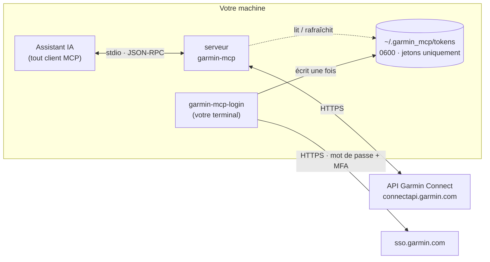

<div align="center">

# garmin-mcp

**Interrogez vos données Garmin. Envoyez vos séances sur votre montre. Votre mot de passe n'est jamais enregistré.**

Un serveur [Model Context Protocol](https://modelcontextprotocol.io) local qui donne aux assistants IA un accès structuré à Garmin Connect. Il lit vos activités, votre sommeil, votre VFC et votre statut d'entraînement, et crée des séances fractionnées qui se synchronisent directement sur votre montre.

[](https://github.com/agogte/garmin_mcp/actions/workflows/ci.yml)

[](LICENSE)


[English](README.md) · **Français**

</div>

<sub>Exemple de session (chiffres fictifs) :</sub>

```text
Vous :       Comment mes sorties longues de ce mois-ci se comparent-elles à celles du mois dernier ?
Assistant :  [list_activities → get_activity_detail ×6]
             Votre allure moyenne en sortie longue est passée de 5:41 à 5:28 /km pour une
             FC moyenne quasi identique (146 → 147 bpm) : votre efficacité aérobie a
             progressé d'environ 4 %. La dérive cardiaque sur le dernier tiers des sorties
             de 18 km est passée de 6,2 % à 3,9 %.

Vous :       Prépare-moi 5×1 km entre 4:30 et 4:45 avec 2 minutes de récup' en trottinant, pour jeudi.
Assistant :  [create_workout → schedule_workout]
             C'est fait : « Fractionné du jeudi » (≈33 min) est dans votre calendrier
             Garmin pour jeudi et se synchronisera sur votre montre.
```

## Pourquoi

Garmin Connect regorge de données, mais n'offre aucune API publique aux particuliers : l'API Health officielle est réservée aux partenaires commerciaux. Les outils communautaires existants vous demandent de mettre votre mot de passe dans un fichier `.env` ou de le confier à un service hébergé. **garmin-mcp choisit l'approche la plus stricte :**

- 🔐 **Votre mot de passe n'est jamais stocké.** Vous le saisissez une seule fois dans une invite masquée ; seul un jeton de session est conservé, lisible uniquement par vous.
- 🏠 **Rien ne quitte votre machine, à part les appels vers Garmin.** Pas de backend, pas de relais, pas de télémétrie, et la CI fait respecter cette frontière réseau.
- ⌚ **Dans les deux sens :** il lit vos données d'entraînement *et* envoie sur votre montre des séances structurées avec de vraies cibles d'allure, de FC et de puissance.
- 🧱 **Du JSON structuré en sortie :** les outils renvoient des données propres aux unités cohérentes (mètres, secondes, m/s). C'est l'assistant qui fait l'analyse, pas la mise en forme.

## Fonctionnement



1. `garmin-mcp-login` échange votre mot de passe (et votre code MFA) contre des jetons de session directement auprès du SSO de Garmin, puis oublie le mot de passe.
2. Votre client MCP lance `garmin-mcp` via stdio. Le serveur reprend la session à partir du fichier de jetons et le rafraîchit automatiquement ; aucun chemin de code n'accepte de mot de passe.
3. Chaque appel d'outil devient une ou plusieurs requêtes vers l'API de Garmin, et le résultat revient sous forme de JSON structuré.

Le modèle de menace complet et l'audit des dépendances sont dans [SECURITY.md](SECURITY.md) (en anglais).

## Démarrage rapide

**Prérequis :** macOS ou Linux, [uv](https://docs.astral.sh/uv/), un compte Garmin Connect.

```bash
git clone https://github.com/agogte/garmin_mcp.git
cd garmin_mcp
./run
```

`./run` installe les dépendances, vous demande vos identifiants Garmin s'il n'y a pas de session valide (le MFA est pris en charge), installe le serveur dans `~/.local/bin/garmin-mcp` et affiche la commande à déclarer dans votre client MCP.

Ajoutez ensuite le serveur à la configuration MCP de votre client. Il ne prend aucun argument et **aucune variable d'environnement** :

```json
{
  "mcpServers": {
    "garmin": { "command": "/Users/vous/.local/bin/garmin-mcp" }
  }
}
```

Redémarrez votre client et demandez-lui par exemple : *« Quels étaient mon score de sommeil et ma FC au repos cette semaine ? »*

## Outils

| Outil | Rôle |
|---|---|
| `list_activities` | Activités récentes, filtrables par période et par sport : durée, distance, FC, allure, puissance, cadence, charge et effet d'entraînement. |
| `get_activity_detail` | Une activité en détail : résumé, tours et splits, temps passé par zone de FC et de puissance, et en option une série temporelle sous-échantillonnée. |
| `get_daily_summary` | Pas, FC au repos, stress, Body Battery, minutes d'intensité, score et phases de sommeil pour une journée. |
| `get_training_status` | Statut et charge d'entraînement, VO2max et disposition à l'entraînement (selon votre appareil). |
| `create_workout` | Crée une séance structurée (course, vélo, natation, marche, randonnée) et l'enregistre dans votre bibliothèque Garmin. |
| `schedule_workout` | Place une séance dans votre calendrier Garmin, d'où elle se synchronise sur la montre. |
| `list_workouts` / `get_workout` / `delete_workout` | Gèrent votre bibliothèque de séances. |
| `list_pacepro_plans` / `get_pacepro_plan` | Vos plans d'allure PacePro : temps et allure cibles, stratégie d'allure et objectifs par fraction (points GPS en option). |
| `create_pacepro_plan` | Crée un nouveau plan PacePro à partir d'une distance et d'un temps cible, avec des fractions au mile ou au km, régulières ou progressivement plus rapides/lentes (`split_change_pct`). La somme des fractions correspond toujours au temps cible. Ne modifie jamais les plans existants. |
| `delete_pacepro_plan` | Supprime un plan PacePro. |

Les sections qui échouent de façon indépendante, comme les zones de puissance d'une course sans capteur de puissance, sont signalées dans un champ `errors` au lieu de faire échouer tout l'appel.

### Format des séances

Un format d'étapes compact et validé. Chaque étape se termine après `duration_s`, après `distance_m`, ou (si aucun des deux n'est indiqué) quand vous appuyez sur le bouton Lap :

```json
[
  {"type": "warmup", "duration_s": 600, "target": {"kind": "hr_zone", "zone": 2}},
  {"type": "repeat", "iterations": 5, "steps": [
    {"type": "interval", "distance_m": 1000, "target": {"kind": "pace", "low": "4:30", "high": "4:45"}},
    {"type": "recovery", "duration_s": 120}
  ]},
  {"type": "cooldown"}
]
```

| `kind` de la cible | Valeurs |
|---|---|
| `pace` | `"m:ss"` par km, ou par mile avec `"unit": "mile"` |
| `speed` | km/h, ou mph avec `"unit": "mile"` |
| `heart_rate` / `power` / `cadence` | plage `low`–`high` (bpm / watts / pas ou tours par minute) |
| `hr_zone` / `power_zone` | numéro de `zone` |

Les séances invalides, comme une répétition sans étapes ou une étape avec à la fois une durée et une distance, sont rejetées avant tout envoi vers Garmin.

## Commandes

```bash
./run                              # installation + démarrage (interactif)
./run --help
uv run garmin-mcp-login            # (re)connexion ; utile seulement si Garmin fait expirer votre session
uv run garmin-mcp-login --check    # vérifie la session enregistrée
uv run garmin-mcp-login --logout   # supprime les jetons locaux
```

## Développement

```bash
uv sync
uv run pytest          # 47 tests, sans réseau : faux client Garmin + client MCP en mémoire
uv run ruff check . && uv run ruff format --check .
uv run pyright
```

```
src/garmin_mcp/
  server.py     serveur MCP et définition des outils
  workouts.py   format d'étapes → JSON de séance Garmin
  auth.py       reprise de session par jeton + CLI de connexion interactive
tests/          tests du générateur de séances, des outils, de l'auth et de la frontière de confidentialité
```

La CI lance le lint, la vérification du formatage, le contrôle de types et les tests sur Ubuntu et macOS pour Python 3.12 à 3.14, ainsi qu'une recherche de secrets avec gitleaks.

## Feuille de route

- **Tableau de bord d'analyse local** (`localhost` uniquement) : courbe forme/fatigue/fraîcheur avec projection au jour de la course, tendances d'efficacité corrigées de la chaleur, découplage aérobie, courbes d'allure et de puissance critiques, corrélations de récupération, carte de chaleur des parcours et couverture des rues.
- **Générateur de plans d'entraînement :** générer un bloc périodisé, l'envoyer sur la montre et évaluer la qualité d'exécution de chaque séance.

## Avertissement

Ce projet est indépendant ; il n'est ni affilié à Garmin ni approuvé par Garmin. Il s'appuie sur la bibliothèque communautaire [`garminconnect`](https://github.com/cyberjunky/python-garminconnect), qui utilise les mêmes points d'accès que l'application Garmin Connect. Ces points d'accès ne sont pas officiels et peuvent changer. À utiliser avec votre propre compte et à vos risques et périls.

## Licence

[MIT](LICENSE) © Advait Gogte
