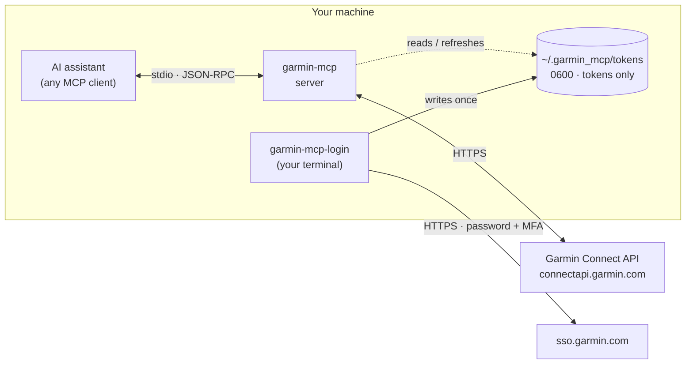

<div align="center">

# garmin-mcp

**Talk to your Garmin data. Push workouts to your watch. Your password never touches disk.**

A local-first [Model Context Protocol](https://modelcontextprotocol.io) server that gives AI assistants structured access to Garmin Connect. It reads activities, sleep, HRV and training status, and builds interval workouts that sync straight to your watch.

[](https://github.com/agogte/garmin_mcp/actions/workflows/ci.yml)

[](LICENSE)


</div>

<!-- Demo screenshot: save one to docs/images/demo.png and uncomment.
<p align="center"></p>
-->

<sub>Example session (illustrative numbers):</sub>

```text
You:       How did my long runs this month compare to last month?
Assistant: [list_activities → get_activity_detail ×6]
           Avg pace on long runs improved from 5:41 to 5:28 /km at nearly the same
           average HR (146 → 147 bpm), so your aerobic efficiency is up ~4%. Cardiac
           drift in the final third dropped from 6.2% to 3.9% on the 18 km runs.

You:       Build me 5×1 km at 4:30–4:45 with 2-minute jog recoveries for Thursday.
Assistant: [create_workout → schedule_workout]
           Done: "Thursday Intervals" (≈33 min) is on your Garmin calendar
           for Thursday and will sync to your watch.
```

## Why

Garmin Connect has great data and no public API for individuals; the official Health API requires a business partnership. Existing community tools ask you to put your password in an `.env` file or hand it to a hosted service. **garmin-mcp takes the stricter route:**

- 🔐 **Your password is never stored.** You type it once into a hidden prompt; only a session token is saved, with owner-only permissions.
- 🏠 **Nothing leaves your machine except calls to Garmin itself.** There's no backend, relay or telemetry, and CI enforces the network boundary.
- ⌚ **Two-way:** it reads your training data *and* writes structured workouts with real pace, HR and power targets to your watch.
- 🧱 **Structured JSON out:** tools return clean, unit-consistent data (meters, seconds, m/s), so the assistant does the analysis, not the formatting.

## How it works



1. `garmin-mcp-login` exchanges your password (and MFA code) for session tokens directly with Garmin SSO, then discards the password.
2. Your MCP client launches `garmin-mcp` over stdio. The server resumes from the token file and auto-refreshes it; it has no code path that accepts a password.
3. Each tool call becomes one or more requests to Garmin's API, and the result comes back as structured JSON.

See [SECURITY.md](SECURITY.md) for the full threat model and dependency audit.

## Quick start

**Requirements:** macOS or Linux, [uv](https://docs.astral.sh/uv/), a Garmin Connect account.

```bash
git clone https://github.com/agogte/garmin_mcp.git
cd garmin_mcp
./run
```

`./run` syncs dependencies, prompts for your Garmin login if there's no valid session (MFA is supported), installs the server to `~/.local/bin/garmin-mcp`, and prints the command to register with your MCP client.

Then add the server to your client's MCP config. It needs no arguments and **no environment variables**:

```json
{
  "mcpServers": {
    "garmin": { "command": "/Users/you/.local/bin/garmin-mcp" }
  }
}
```

Restart your client and ask it something like *"What was my sleep score and resting HR this week?"*

## Tools

| Tool | What it does |
|---|---|
| `list_activities` | Recent activities, filterable by date range and sport. Duration, distance, HR, pace, power, cadence, training load, training effect. |
| `get_activity_detail` | One activity in depth: summary, laps/splits, HR and power time-in-zone, plus an optional downsampled time series. |
| `get_daily_summary` | Steps, resting HR, stress, body battery, intensity minutes, and sleep score and stages for a day. |
| `get_training_status` | Training status and load, VO2max, and training readiness (depends on your device). |
| `create_workout` | Builds a structured workout (run, bike, swim, walk, hike) and saves it to your Garmin library. |
| `schedule_workout` | Puts a workout on your Garmin calendar, from where it syncs to the watch. |
| `list_workouts` / `get_workout` / `delete_workout` | Manage your workout library. |

Sections that fail independently, such as power zones for a run without a power meter, are reported in an `errors` field instead of failing the whole call.

### Workout format

A compact, validated step format. Each step ends after `duration_s`, after `distance_m`, or (if neither is set) when you press the lap button:

```json
[
  {"type": "warmup", "duration_s": 600, "target": {"kind": "hr_zone", "zone": 2}},
  {"type": "repeat", "iterations": 5, "steps": [
    {"type": "interval", "distance_m": 1000, "target": {"kind": "pace", "low": "4:30", "high": "4:45"}},
    {"type": "recovery", "duration_s": 120}
  ]},
  {"type": "cooldown"}
]
```

| Target `kind` | Values |
|---|---|
| `pace` | `"m:ss"` per km, or per mile with `"unit": "mile"` |
| `speed` | km/h, or mph with `"unit": "mile"` |
| `heart_rate` / `power` / `cadence` | `low`–`high` range (bpm / watts / spm or rpm) |
| `hr_zone` / `power_zone` | `zone` number |

Invalid workouts, like a repeat with no steps or both a duration and a distance, are rejected before anything is sent to Garmin.

## Commands

```bash
./run                              # setup + start (interactive)
./run --help
uv run garmin-mcp-login            # (re)login; only needed if Garmin expires your session
uv run garmin-mcp-login --check    # verify the saved session
uv run garmin-mcp-login --logout   # delete local tokens
```

## Development

```bash
uv sync
uv run pytest          # 39 tests, no network: fake Garmin client + in-memory MCP client
uv run ruff check . && uv run ruff format --check .
uv run pyright
```

```
src/garmin_mcp/
  server.py     MCP server and tool definitions
  workouts.py   step format → Garmin workout JSON
  auth.py       token-only session resume + interactive login CLI
tests/          workout builder, tools, auth, privacy-boundary tests
```

CI runs lint, format, type check and tests on Ubuntu and macOS for Python 3.12–3.14, plus a gitleaks secret scan.

## Roadmap

- **Local analytics dashboard** (`localhost` only): a fitness/fatigue/form chart with race-day projection, heat-adjusted efficiency trends, aerobic decoupling, critical pace/power curves, recovery correlations, route heatmaps, and street coverage.
- **Training-plan builder:** generate a periodized block, push it to the watch, and score how well you executed each session.

## Disclaimer

This is an independent project, not affiliated with or endorsed by Garmin. It uses the community-maintained [`garminconnect`](https://github.com/cyberjunky/python-garminconnect) library, which talks to the same endpoints as the Garmin Connect app. Those endpoints are unofficial and can change. Use it with your own account and at your own risk.

## License

[MIT](LICENSE) © Advait Gogte
